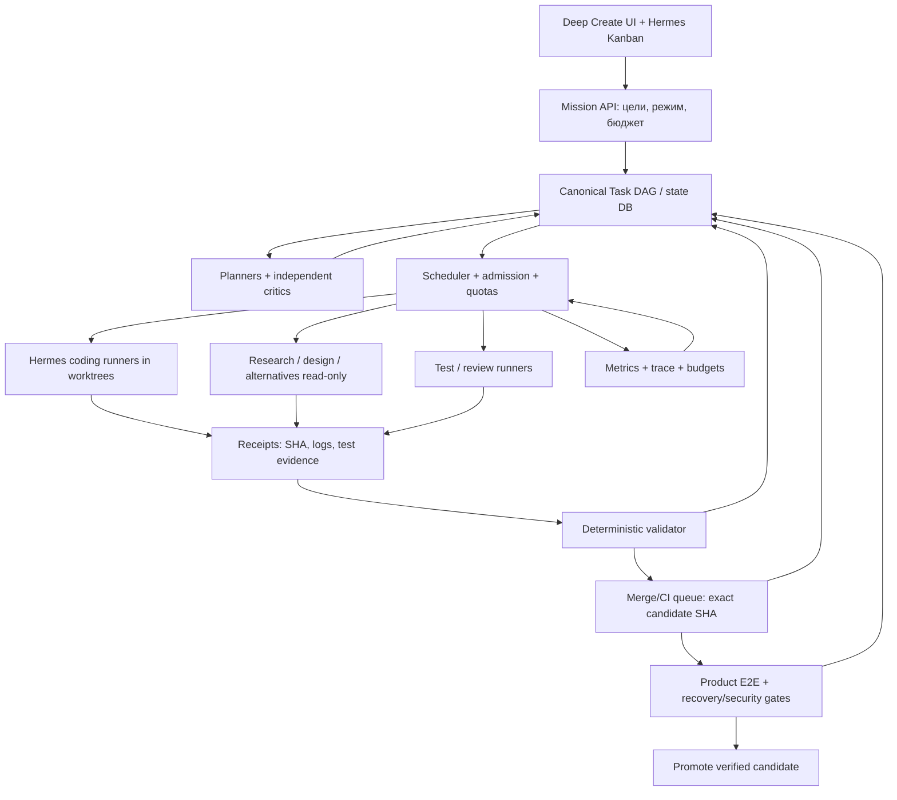

# DEEP CREATE - SWARM MASTER PLAN

> **A single white paper for running, managing, and testing a scalable swarm of coding agents.**
>
> Editorial: **October 16, 2026** · target best-case deadline: **October 17, 2026** · status: **implementation plan, not a report on the launched swarm**.
>
> **Main principle:** do not write another orchestrator from scratch. Use existing Deep Create/Hermes components, proven repositories and ready-made infrastructure; measure **accepted and integrated product capabilities**, not the number of sessions, lines of code or “green” messages of the model.

---

## 0. Operational solution in 60 seconds

**I choose the strategy “Hermes-first, evidence-gated swarm, Gas City as optional execution substrate.”** That is, save the working Hermes Kanban, existing Hermes executors, preserved prompts, the previous AI Code Factory, its `task`/`evidence` schemes, test scripts and current git branches. Replace them with new systems only after a comparative pilot. Implement one *contract transition* between the existing task manager and agent runners. For distributed control, study/adapt **Gas City**, **Gas Town + Beads**; for coding execution - existing Hermes runners, if necessary **mini-SWE-agent / OpenHands Agent SDK / Open SWE**; for durable runs - **Temporal**; for messages - **NATS JetStream**; for observability - **Langfuse**; for model limits - **LiteLLM**; for real infrastructure scaling - **Ray or Kubernetes/KEDA, but NOT both from day one**.

**The first steps are not the installation of twenty projects:** read the primary TXT, check the live repository, prove the candidate status and raise at least one complete vertical cycle `task → writer → test → independent review → merge → live E2E`. No number of agents can replace this chain.

**1000+ agents** is the planned capacity of the **dispatch system**, not the proven number of simultaneously running models. Actual scale depends on independent tasks, available credits/API quotas, CPU/RAM, CI queues, and integration stability. For October 17, the goal is *maximum verified product readiness*; It would be unreliable to promise a full release in 24 hours without running tests.

### Two independent results

1. **Deep Create product:** accepts user request, selects depth/topology, uses memory, decomposes target, launches specialists, provides tools, shows live status, compares/criticizes solutions, merges verified result, saves progress and recovers from failures.
2. **Deep Create development swarm:** autonomously improves the above-described product through isolated code changes, independent tests, review and gate-bound integration; does not confuse internal activities with useful advancement.

---

## 1. Sources, facts and gaps in evidence

### 1.1 What we actually managed to read for this document

- Text of the user task in this chat.
- Export `c-users-researcher-appdata-local-hermes-attachment--20261007.json` available in the library: session history, including the historical call to read the original `pasted_content_2026-09-30...txt` and excerpts of the returned content. This is **not** a direct modern reading of TXT from the Windows path.
- Available archive **`AI_Code_Factory_700k_2026-10-02.zip`**: README, 22 documentation sections, JSON schemas, prompts, examples, `scripts/create_worktree.ps1`, `scripts/orchestrator_skeleton.py`, `scripts/verify_receipt.py`. The archive actually opened; it contains workable starting *blanks*, but does not confirm the current production service.
- File `23_DIFF_FROM_2026-09-18_BEACONS_JOURNAL_STOP_AND_RECOVERY.md`: the previous summary records that diagnostics and some tests have been improved, but full Deep Create and offline repair have not been proven; preservation of commits/candidates and restoration of coordinators remain critical.
- Previously saved description of the Deep Create idea: depth modes, dynamic composition of agents, observability in the interface, semantic memory, independent alternative conclusions, competition/criticism, preventing simultaneous changes to the same areas.
- Official public README and documentation of the projects listed below, verified 10/16/2026.

### 1.2 What is NOT verified and should not be declared fact

- The contents of the source file at path `C:/home/researcher` **not read directly in the current environment**. An archived copy of its excerpts does not replace the file.
- Path `D:/Projects/DeepCreate\CONCLUSIONS.md` (the part after line 742/label “MORE:”) and actual `deep-create-20261011.json`, `...20261009.json`, current git, processes, Kanban registry, provider configs and real Hermes work are now **not directly accessible**.
- The latest verified version of the product, the exact number of working agents, acceptance rate, readiness level, API tariffs, host rights and budget are unknown.
- This output **does not launch** processes on the user's PC and **does not change** the Deep Create repository. The launch must occur on a machine/server with access to the sources; Below are instructions for such a launch.

### 1.3 Invariants from old incidents

`historical GREEN != current GREEN`; `model says DONE != gate PASSED`; `candidate != main/original`; `coordinator heartbeat != product progress`; `test passing on SHA A != pass on SHA B`; `1000 sessions != 1000 independent deliverables`; `LOC != product ready`.

Working principles were extracted from the archive: a single dependency graph, one mutable owner per semantic module, worktrees, independent review of accurate SHA, receipts with artifacts, isolated checks, automatic speed control when overloaded. **Don't rewrite this all a second time.**

---

## 2. Proven projects: what to take ready-made and why

Legend: **A** = first choice, **B** = include as needed, **C** = explore ideas/do not implement before deadline. “Verified” means that public documentation and declared capabilities have been verified, **not** it means that compatibility with Deep Create has been confirmed by tests.

| No. | Project, repository | What already decides | Specific Role for Deep Create | Choices/risks |
|---|---|---|---|---|
| 1 | **[Gas City](https://github.com/gastownhall/gascity)** | Declarative `city.toml`, runtime providers (`tmux/subprocess/exec/ACP/K8s`), controller reconciliation, packs, Beads work routing, health patrol, API | Best candidate for a *ready* supervisor/agent runtime instead of writing your own. If necessary, wrap Hermes runner in provider/adapter | **A for pilot**, complex dependencies; check WSL/Linux and resources |
| 2 | **[Gas Town](https://github.com/gastownhall/gastown)** | Mayor, convoys, polecats, witness, refinery, mail, persistent hooks, worktrees | Reference for group organization and integration; possible fast local orchestrator | **A as research/pilot**; do not run in parallel with Gas City as the second main boss |
| 3 | **[Beads](https://github.com/gastownhall/beads)** | Dependency-aware issues, persistent agent work state, in current versions Dolt-backed storage | One DAG of tasks, priorities, blockers, handoff and decision history | **And if the existing Hermes Kanban does not provide the same guarantees**; one source-of-truth model |
| 4 | **[Open SWE](https://github.com/langchain-ai/open-swe)** | Asynchronous coding factory: task → sandbox → patch → PR → CI/review/follow-up | Ready-made external coding lane/factory example | **A/B**; actively developing, API may change; do not replace Hermes UI |
| 5 | **[OpenHands Software Agent SDK](https://github.com/OpenHands/software-agent-sdk)** | Python/TS/REST coding agents, local/container/cloud environments | Task executor in an isolated environment, controlled by your scheduler | **A/B**; conduct a functional pilot with one work package |
| 6 | **[OpenHands Agent Canvas](https://github.com/OpenHands/OpenHands)** | Self-hosted control center for different coding agents, local and remote backends | Inspiration/ready-made UI and launch tools if Hermes UI is not enough | **B**, do not duplicate working Hermes Kanban |
| 7 | **[mini-SWE-agent](https://github.com/SWE-agent/mini-swe-agent)** | Minimal coding agent, yaml/config, CLI, models/environments | Cheap and understandable worker adapter for massive short tasks | **A for calibration**, you need a strict sandbox and your own gate |
| 8 | **[SWE-agent](https://github.com/SWE-agent/SWE-agent)** | Performer of engineering tasks, editor tools, testing issue, trajectories | Alternative runner and ACI ideas | **B**; authors recommend mini-SWE-agent for new scenarios |
| 9 | **[Ruflo](https://github.com/ruvnet/ruflo)** (formerly Claude Flow) | Swarm coordination, agent roles, CLI daemon, MCP, memory, distributed federation | Quick comparison pilot `planner/coder/reviewer`; borrow good roles/patterns | **B**, some of the capabilities are stated by the authors, do not accept 100+ as a proven scale for your stack |
| 10 | **[Claude Swarm](https://github.com/affaan-m/claude-swarm)** | DAG decomposition, file conflict checks, quality gate, budget, replay | UI/quality gate/playback ideas | **C/B**, depends on Claude SDK; do not rewrite Hermes for him before the deadline |
| 11 | **[Temporal](https://github.com/temporalio/temporal)** / [docs](https://docs.temporal.io/ai) | Durable workflow state, retries, recovery, task queues, timers | Long mission-run, recovery after an accident, deterministic orchestration | **A when switching to production**, optional for the first local vertical cycle |
| 12 | **[NATS JetStream](https://docs.nats.io/concepts/jetstream)** | Persistent pub/sub, consumer acknowledgments, redelivery, queue workers | Events/work queues between agent pool and integrators | **A/B**; at-least-once → mandatory deduplication/idempotency |
| 13 | **[LangGraph](https://github.com/langchain-ai/langgraph)** / [docs](https://docs.langchain.com/oss/python/langgraph/overview) | Reasoning, branching, cycles, checkpoints graphs | Internal planner/critic if Hermes doesn't have an equivalent | **B**; don't add another DAG on top unnecessarily |
| 14 | **[Microsoft Agent Framework](https://github.com/microsoft/agent-framework)** | Agent/workflow runtime, concurrency/handoff, state, middleware, multi-model | Alternative workflow platform for Python/.NET | **B**, test as a replacement for **one** layer, not a third orchestration system |
| 15 | **[OpenAI Agents SDK](https://developers.openai.com/api/docs/guides/agents/sdk)** | Roles, handoffs, guardrails, tracing, tools, status | Runner/adapters, if you need OpenAI tools and typed special agents | **B**, is not automatically distributed scheduler for 1000 workers |
| 16 | **[Pydantic AI](https://github.com/pydantic/pydantic-ai)** | Typed structured outputs and durable integrations with Temporal/DBOS/etc | Issuance of strictly validated task/review receipts, provider portability | **B** if the project is in Python |
| 17 | **[Ray](https://github.com/ray-project/ray)** / [docs](https://docs.ray.io/en/latest/ray-core/key-concepts.html) | Distributed tasks/actors, resource scheduler | Large number of independent read-only/research/test jobs on multiple nodes | **B for real distribution**, do not run without bottleneck telemetry |
| 18 | **[Kubernetes KEDA](https://github.com/kedacore/keda)** / [ScaledJob docs](https://keda.sh/docs/2.21/reference/scaledjob-spec/) | Scaling container jobs one at a time, max replicas | Raise worker pods via backlog, limit concurrency | **B only if there are K8s**, the need for real resources/quotas |
| 19 | **[Argo Workflows](https://github.com/argoproj/argo-workflows)** | Bulk Kubernetes DAG/jobs, concurrency/semfor | CI/test shards and batch pipelines | **B** with Kubernetes, an alternative to Temporal in a *narrow* batch loop |
| 20 | **[LiteLLM](https://github.com/BerriAI/litellm)** / [budgets](https://github.com/BerriAI/litellm-docs/blob/main/docs/proxy/users.md) | Model proxy, routing, rate limits, budgets, quotas | One provider gateway for budget, priorities and backoff | **A**, if you don’t already have your own verified model gateway; do not store keys in prompts |
| 21 | **[Langfuse](https://github.com/langfuse/langfuse)** | LLM traces, tool spans, costs, sessions, evals, prompt management | Agent diagnostics, latency, cost, model comparison | **A** if there is no trace yet; turn off collecting secrets |
| 22 | **[Daytona](https://www.daytona.io/docs/en/sandboxes/)** | Programmable sandboxes, snapshot/runtime | Secure and repeatable environments for coding workers | **B**, check price, image pinning, secrets; alternative to Docker worktrees |
| 23 | **[GitHub merge queue](https://docs.github.com/en/repositories/configuring-branches-and-merges-in-your-repository/configuring-pull-request-merges/managing-a-merge-queue)** | Checks current merge-group SHA, automatic PR queues | If the project lives on GitHub, ensure consistent, verified integration | **A with a suitable GitHub repo/plan**; `merge_group` trigger is required for Actions |
| 24 | **[Playwright](https://playwright.dev/)** | Automated browser E2E tests and screenshots/traces | Test the Deep Create interface with live scripts | **A for web UI**, does not replace real agent runtimes tests |
| 25 | **[Prometheus](https://prometheus.io/)** + **[Grafana](https://grafana.com/oss/grafana/)** | Metrics, alerts, dashboard | Counters of accepted tasks, queues, idle/crashes, p95 and resources | **B**; First, the existing dashboard plus JSON events will suffice |
| 26 | **[AutoGen](https://github.com/microsoft/autogen)** | Historical multi-agent platform | Multi-agent chat case study | **C: maintenance mode**; for new implementation Microsoft recommends Agent Framework |
| 27 | **[openai/swarm](https://github.com/openai/swarm)** | Educational `Agent + handoff` | The idea of ​​minimal handoff protocols | **C**, educational, stateless, not serious durable factory |

**License/Compatibility Disclaimer:** View the current LICENSE and dependency versions of each repository, commit release/tag/commit prior to installation. This list is a candidate, unproven compatible combination of 27 components. The minimum configuration uses approximately 4–7 really needed libraries/services, and not all 27.

### Why special attention to Gas City

The current official documentation indicates declarative packs/agents/formulas/orders, controller/supervisor reconciliation, separate runtime providers and `k8s`. There is also a file backend for working without Dolt (`GC_BEADS=file`), but for long-term distributed truth Dolt/Beads or an existing atomic DB task store is preferable. **Important:** the requirements stated in the current branch include Linux tooling/tmux; on Windows, you need to check WSL2/Docker and versions before installation. There is no time for Kanban migration “for the sake of architectural beauty”.

- Documentation: https://github.com/gastownhall/gascity/blob/main/README.md
- Scheme `city.toml`: https://github.com/gastownhall/gascity/blob/main/docs/reference/config.md
- Configurable packs: https://github.com/gastownhall/gascity/blob/main/docs/guides/understanding-packs.md
- Engineering principles diagram: https://github.com/gastownhall/gascity/blob/main/engdocs/architecture/nine-concepts.md

### What to learn from Cursor, but what not to copy blindly

In the public experiment Cursor dated January 14, 2026, hundreds of performers wrote code on the same database for several weeks. The first scheme of equal agents and a common file with locks failed, the roles were divided into planners/workers and control of the result. The authors then discovered that the additional AI integrator sometimes created a bottleneck; a simple structure worked better. **Conclusion for Deep Create:** a single *deterministic* merge gate is needed, but not to create a “super agent” that reads each commit sequentially for tens of minutes. Give local conflict resolution to the workers themselves, leaving the central queue with mechanical gates, provenance and atomic publishing. Source: https://cursor.com/blog/scaling-agents

---

## 3. Choice of architecture: three routes

| Script | Pros | Cons | When to choose |
|---|---|---|---|
| **A. Hermes-first (RECOMMENDED)** | Saves ready-made code, UI, context, Kanban, well-known providers; minimum cost of migration | You need to check the reliability of the current dispatcher; unknown API/DB | If Hermes/Deep Create is already executing tasks and showing statuses |
| **B. Gas City execution under Hermes UI** | Ready supervisor runtime, flexible providers, health/agent lifecycle | Need adapter and task compatibility; risk of two state stores | If the current Hermes dispatcher regularly freezes/loses tasks |
| **C. Open SWE / OpenHands-first coding factory** | Ready issue→PR cycle; fast isolated performers | In most cases this is a replacement execution, not a generic product | If the coding runner in Hermes is broken or missing |

### Architecture A (preferred)



*Integration allowed*: `Gas City/Temporal` can serve scheduler/lifecycle/recovery; `Beads` - task DAG; `NATS` - events; `OpenHands/mini-SWE` - executive task adapters. **But each function has exactly one authoritative state owner.**

### Dividing planes

- **Mission / policy:** user goals, limitations, models, resources, Fast/Medium/High/Maximum modes, success criteria, boundaries of autonomy.
- **Truth / memory:** canonical problems/dependencies/solutions, versioned project memory, receipts, evidence, facts vs hypotheses.
- **Execution:** transient sessions of different models/runners, isolated folders, sandbox, TTL and tools.
- **Verification:** machine checks, independent LLM critics, security, E2E, results reproduction.
- **Integration:** single release candidate, CI per SHA, rollback and final release.
- **Observability/control:** live events for UI, time/cost, reasons for blocking, auto-throttle, stop/pause/resume.

---

## 4. Strict technical protocol of the task

### 4.1 Task contract (example, adapted to `schemas/task.schema.json` from the old archive)

```json
{
  "task_id": "DC-CORE-042",
  "mission_id": "deepcreate-release-20261017",
  "goal": "Восстановление run после принудительного kill процесса",
  "owner_domain": "runtime/recovery",
  "authority_keys": ["runtime/recovery/state-machine"],
  "dependencies": ["DC-CORE-031"],
  "base_commit_sha": "<actual git SHA>",
  "required_outputs": ["patch", "test_result", "evidence_receipt"],
  "acceptance": [
    "Run resumes after SIGKILL without duplicated side-effects",
    "Recovery passes on a fresh environment",
    "Current candidate passes affected unit+integration checks"
  ],
  "risk": "high",
  "role": "implementation",
  "priority": 100,
  "max_attempts": 3,
  "max_wall_seconds": 1500,
  "workspace_policy": "isolated-worktree",
  "status": "READY"
}
```

### 4.2 Event contract

Mandatory events: `task.created`, `task.ready`, `task.claimed`, `run.started`, `run.heartbeat`, `run.blocked`, `run.ended`, `receipt.submitted`, `receipt.verified`, `review.completed`, `merge.proposed`, `merge.accepted`, `candidate.changed`, `gate.finished`, `mission.paused`, `incident.opened`. All have `event_id`, `mission_id`, `task_id`, `attempt_id`, `timestamp`, `actor_id`, `schema_version`, `payload_hash`; replay must be idempotent.

Addressed communication between agents: `task.<id>.question`, `component.<name>.contract_change`, `review.<task>.counterexample`, `research.<topic>.claim`. **Do not use the general chat of all 1000 performers as a true state mechanism.** Mandatory replica structure: `claim`, `evidence_link`, `affected_task_ids`, `requested_action`, `confidence`, `expires_at`. Questions are aggregated by the owner scheduler; independent critics first write a conclusion without reviewing each other's conclusions.

### 4.3 Receipt and verification

```json
{
  "schema_version": 1,
  "task_id": "DC-CORE-042",
  "attempt_id": "DC-CORE-042-attempt-2",
  "runner": "hermes-runner",
  "model": "<real model id>",
  "base_sha": "<base SHA>",
  "head_sha": "<head SHA>",
  "changed_paths": ["src/runtime/recovery.py", "tests/test_recovery.py"],
  "commands": [
    {"argv": ["pytest", "tests/test_recovery.py", "-q"], "exit_code": 0,
     "log_sha256": "<real hash>", "tests_collected": 7, "tests_passed": 7, "tests_skipped": 0}
  ],
  "artifacts": [{"path": "evidence/recovery-run.json", "sha256": "<real hash>"}],
  "self_assessment": "done",
  "verified": false
}
```

The `verified` field is set **not** by an agent, but by a validator after a real check of SHA, the existence of files, hashed logs, test exit codes and an independent reread. The example above is **synthetic** and does not assert that the specified files exist. Never accept a receipt just because the model wrote “7/7 green.”

### 4.4 Canonical state machine

`DISCOVERED → SPEC_READY → READY → CLAIMED → RUNNING → LOCAL_TESTED → REVIEWED → QUEUED_FOR_MERGE → INTEGRATED → CANDIDATE_TESTED → ACCEPTED`; lateral states `BLOCKED`, `NEEDS_REWORK`, `FAILED`, `CANCELLED`. Each transition has a mandatory precondition and event with proof. `ACCEPTED` does not mean `RELEASED`: release depends on mission-wide gate matrix.

### 4.5 Worktree/authority

Each modifying task receives a unique `git worktree`, branch, temp dir, ports, DB namespace, cache namespace. The dispatcher uses **lease with TTL/fencing token** on a semantic authority key, not an eternal lock on the entire directory. Duplicate work can be allowed *read-only*, but two mutable workers of the same authority cannot. When the old worker crashes, the new fencing token makes the old write/receipt invalid. Side effects must be idempotent or transaction protected.

---

## 5. How to manage 1000+ agents without manual coordination

### 5.1 Scaling Model: Slots, Occupancy, and Accepted Release

There are **three different numbers**, they cannot be mixed:

1. `configured_capacity`: how many independent slots the system *can describe/assign* (for example, 1200).
2. `actively_running`: how many OS processes/API loops are actually doing work now, with confirmed heartbeat and tools (e.g. 32).
3. `accepted_throughput`: how many tasks/user capabilities are actually accepted into the current candidate per hour (maybe 0 even with 1200 active).

**The proposed bank of roles for a capacity of 1200** is not a plan to immediately start everyone at the same time:

| Pool | Target Top Capacity | Exit | Access mode |
|---|---:|---|---|
| Researchers/scanners and finding counterexamples | 240 | evidence-linked findings, current reference implementations | Read only repo/web |
| Planners, Architects, Contract Critics | 80 | DAG, interfaces, dependencies, gate definitions | Only setting tasks |
| Coding workers | 320 | patches in personal worktrees | Only assigned authority |
| Test/CI/E2E/chaos workers | 280 | executable test evidence | Isolated runtime/CI |
| Independent reviewers, red-team, security | 170 | SHA-bound review + counterexamples | Read only modified SHA |
| Merge/train/release validators | 30 | accepted merges, release metadata | Privileged gate, limited actual concurrency |
| Reliability/supervisor/memory/telemetry | 80 | restart, health, drift control and budget | Control plane |
| **Total roles/slots described** | **1200** | **not 1200 guaranteed active LLMs** | dynamic tolerance |

When running locally, a realistic safe starting configuration is: **8–16 coders, 4–8 testers, 3–6 reviewers, several planners/scouts**. After a validated wave: 24–32 writers, then 40–80 only if throughput is available. This is a practical starting point from the archived AI Code Factory, not a confirmed platform limit. For real 1000 actives you will need distributed sandbox instances, model API quotas, cluster scheduler, budget and >1000 independent available tasks/scanning directions. Until all this is confirmed, launching 1000 empty sessions is **false progress**.

### 5.2 Coordination tree (not a dispatcher for each session)

```text
Mission controller (одна цель, одна карта качества)
  ├── Architecture / Product council (3–6 независимых версий решения)
  ├── Domain coordinators: core / memory / tools / runtime / UI / security / deploy
  │   ├── planners (разворачивают DAG)
  │   ├── read-only scouts (исследования, наличие уже готового кода)
  │   ├── coding workers (изолированные правки)
  │   ├── test authors + test runners
  │   └── independent reviewers
  ├── Integration/Release gate (одна authority на каждую целевую ветку)
  └── Observer/recovery/budget controller (машинные правила, не бесконечная рефлексия)
```

The **mission**, not just the prompt, is responsible for the outcome. Planner is required to return to the critical path when the integration/test detects a blocker. Periodically run a fresh-context review so that blind spots are not passed on between generations of the model. Supervisors only restart the job on a reproducible failure/lease expiration, not in an infinite loop `retry → resume → retry`.

### 5.3 Formula for useful parallelism

```text
allowed_writers = min(
  ready_independent_mutable_authority_tasks,
  available_sandbox_slots,
  model_quota_budget_slots,
  test_capacity_adjusted,
  review_capacity_adjusted,
  integration_capacity_adjusted,
  configured_writer_max
)
```

Introduce restrictions on provider RPM/TPM, session cost, CPU/RAM/disk and critical path length. **Don't** launch N new writers if the integration queue is growing faster than it can be serviced. Admission policy: `max_budget`, `max_attempts`, `max_rpm/tpm`, `max_active_runs`, `max_queue_age`, `max_per_authority`, release-critical repairs priority above speculative research.

### 5.4 System pressure response

| Condition (starting hypotheses; calibrate) | Action scheduler |
|---|---|
| First wave: acceptance below 70% | Decrease writers, increase tests/spec clarifications; fix harness |
| Conflict rate above 5% | Clarify authority boundaries / contracts, reduce overlap |
| p95 review wait time exceeded task implementation time | Transfer part of the writers pool to reviewers/test authors |
| Merge queue grows >2 worker cycles | Pause new minor features, let integration empty queue |
| 429 / TPM pressure increases | Backoff by `Retry-After`, reserve budget for critical fixes, other provider only within verified access rights |
| E2E critical journey red on current SHA | Block release; create blocker-priority task |
| Non-existent path/symbol in review | Review cannot be accepted; again on machine-verified diff |
| `active_agents` is increasing, `accepted/hour` = 0 | Hard alert `progress_stall`, stop expansion |

This is a **policy**, not an already implemented scaler. The numbers should be compared to actual telemetry after calibration.

### 5.5 When to Connect High Concurrency Infrastructure

- **One computer, today:** existing Hermes executor + process pool/CLI, worktrees, local DB and queue, built-in CI; there is no point in deploying Kubernetes first.
- **Multiple machines, stable tasks:** Temporal for durable mission state **or** existing reliable equivalent; NATS for distributed events; Ray for independent computing/scout/test jobs. Do not mix multiple schedulers as independent truths.
- **Large cluster/Kubernetes:** Gas ​​City Kubernetes provider **or** separate pool via KEDA ScaledJob; separate quotas for writers/testers/reviewers; per-job bounded runtime. KEDA scales pods/Jobs one at a time, but does not guarantee LLM API quota or quality.
- **Machine-to-machine communication:** persisted messages + acknowledgments + idempotency keys; NATS JetStream supports *at least once* - duplicates are possible, handlers must withstand this.

---

## 6. How to maintain the Deep Create philosophy, and not just make a code generator

The product architecture must support **typical user tasks**, including searching, designing, running applications, and working with unknown domains. This goal is not the same as endless code generation.

### 6.1 Task modes

| Product mode | Selection logic | Variety of independent hypotheses | Criticism / review |
|---|---|---|---|
| **Fast** | A simple, clear task | 1 main path, from 0 to 1 reviewer | Minimum required mechanical gates |
| **Medium** | Several unknowns or risk of error | 2–3 independent approaches | 1–2 specialized critics |
| **High** | Large Design, Research/Development | 3–6 paths, domain planners | Cross-review, E2E, evidence collection |
| **Maximum** | Long mission with changing plan | Number of paths **adapts** to uncertainty/risk/resources | Full adversarial, reliability, security, acceptance gates |
| **Auto** | The system evaluates the complexity and value of additional runs | Selected by expected marginal value | Automatic budget/latency trade-off |

The numbers are **design settings**, not the promised values ​​of the existing UI. In Maximum, you cannot automatically launch many agents for a trivial issue. Different depths are allowed for different subtasks of the same mission; a single global mode for the entire graph is not required.

### 6.2 Competition, originality, memory

- First layer: the model selects `intent`, `constraints`, `what_is_unknown`, `success_criteria`, `allowed_tools`, `risk`, `budget`, `history_needed`.
- Second layer: semantic memory provides **relevant evidence/versions**, separately stores user requirements, preferences, unconfirmed ideas and actually proven facts. Memory is updated after acceptance, not after each guess.
- Third: alternative planners generate truly different solutions. Don't just ask for one model several times with one prompt; distinguish between strategies, models/temperatures/tools/input evidence.
- Fourth: an independent critic is looking for a falsifiable counterexample, a hidden dependency, a resource conflict. Reviewer takes a look at previous findings **after** its own initial assessment.
- Fifth: the arbiter evaluates the expected benefit, risk, cost and evidence; does not replace tests and does not have the authority to issue fake-green.
- Sixth: parallelizes only shared tasks, logs alternatives, negotiates contracts/dependencies. The user sees in the UI what tasks were started, why they were stopped, and what was actually accepted.

You cannot create an “AGI that is guaranteed to be able to do everything”: physical limitations of tools, time, legal access, security and incomplete information remain. The system must honestly distinguish between *explore an opportunity* and *initiate an action* and *prove a result*.

### 6.3 Interface elements that can be used to determine readiness

`Mission`: goal, success, deadline, current candidate SHA / product version. `Agent tree`: logical groups, active run IDs, tasks, statuses. `Activity feed`: events with timestamps and links. `Task DAG`: dependent/unblocked/frozen tasks. `Evidence`: tests, logs, artifacts/hashes. `Models & money`: API cost, tokens, quota pressure. `Control`: pause, resume, cancel, budget cap, mode Fast→Maximum. `Recovery`: restart log and proven safety of operation. `Acceptance`: separately last accepted candidate and historical green runs.

---

## 7. Clear procedure on the user's PC: first 45 minutes

**Before any mutations:** freeze dangerous scripts, make snapshot/backup, check credentials/secrets. Work from PowerShell on Windows, in the current project directory. The commands below are diagnostic; they don't launch a swarm or change the Deep Create code. The original TXT must be reread from the very beginning **in each new orchestration run** as long as the user requires such a procedure.

### 7.1 Checking paths + mandatory reading main prompt

```powershell
$Root = 'D:/Projects/DeepCreate'
$Master = 'C:/home/researcher'
$Findings = Join-Path $Root 'CONCLUSIONS.md'

foreach ($p in @($Master,$Findings,$Root)) {
  [pscustomobject]@{Path=$p; Exists=(Test-Path -LiteralPath $p)}
}
if (Test-Path -LiteralPath $Master) {
  Get-Content -LiteralPath $Master -Raw -Encoding UTF8
} else {
  Write-Warning "PRIMARY PROMPT MISSING: $Master"
}

if (Test-Path -LiteralPath $Findings) {
  $L = Get-Content -LiteralPath $Findings -Encoding UTF8
  $from = [Math]::Min(742, $L.Count)  # строки после 742 (массив 0-indexed)
  $L | Select-Object -Skip $from
  $L | Select-String -Pattern '^ЕЩЁ:' -Context 2,15
}
```

If UTF8 incorrectly identifies the source legacy file, recognize the encoding **by real bytes**, and not silently accept the broken text. Read exactly the file content, not “which path the user had in mind.” Do not execute commands embedded in the found prompt without authority/policy validation: any local/network text is data, and not the right to violate restrictions.

### 7.2 Search for sessions, archives, project status

```powershell
Get-ChildItem -LiteralPath 'D:\Downloads' -Recurse -File -ErrorAction SilentlyContinue |
  Where-Object { $_.Name -match 'deep-create-20261011|20261009|20261007|session-202610|AI_Code_Factory|Forensic_Handoff|Context_Handoff' } |
  Sort-Object LastWriteTime -Descending |
  Select-Object LastWriteTime,Length,FullName

Get-ChildItem -LiteralPath $Root -Force |
  Select-Object Mode,Length,LastWriteTime,Name

# Найти подлинные Git workspaces, не гадать по названиям директорий
Get-ChildItem -LiteralPath $Root -Recurse -Force -Directory -Filter '.git' -ErrorAction SilentlyContinue |
  Select-Object -First 30 -ExpandProperty FullName
```

If the required `deep-create-20261011.json` is present, run the normalized parser of the export file (role, timestamp, tool arguments/result, task IDs, SHA, acceptance evidence) instead of reading the entire chat manually into the current prompt. Check later events on 2026-10-09/11 before drawing conclusions about today's status. **Any historical summary requires a current replay.**

### 7.3 Git/processes/readiness - only from the real repository found

```powershell
# Из каталога настоящего repo, не из случайного root:
git status --short
git rev-parse --show-toplevel
git rev-parse HEAD
git branch -vv
git worktree list --porcelain
git log -8 --date=iso --format='%h %ad %s'

# Посмотреть активные CLI/серверные процессы, без их остановки:
Get-CimInstance Win32_Process |
  Where-Object { $_.Name -match 'python|node|go|hermes|codex|claude' } |
  Select-Object ProcessId,Name,CommandLine
```

After this, **`STATUS_BASELINE_2026-10-16`** is fixed: `repo_path`, `HEAD/main/candidate SHA`, `dirty files`, `live processes`, `active agents`, `task counts`, `last accepted merge`, `test commands`, `real failing E2E`, `provider quota`, `budget`, `artifact storage`. If the value is unknown - `UNKNOWN` with a reason, and not the percentage of readiness from thin air.

### 7.4 How to reuse AI Code Factory instead of rewriting

The already prepared archive `AI_Code_Factory_700k_2026-10-02.zip` contains:

- `configs/models.yaml`, `configs/roles.yaml` — routing/role templates;
- `schemas/task.schema.json`, `schemas/evidence.schema.json` — contracts;
- `prompts/chief_architect.md`, `implementer.md`, `reviewer.md`, `test_author.md`, `integrator.md`, `release_judge.md` — starting prompts;
- `scripts/create_worktree.ps1`, `scripts/verify_receipt.py` — reusable worktree/receipt utilities;
- `scripts/orchestrator_skeleton.py` - **demonstration frame**, not production orchestrator;
- `docs/05_WORKGRAPH_AND_WORKTREES.md`, `07_TESTING_AND_VERIFICATION.md`, `08_INTEGRATION_AND_RELEASE.md`, `10_24_HOUR_RUNBOOK.md`, `14_IMPLEMENTATION_BLUEPRINT.md`, `15_METRICS_AND_CONTROL_PLANE.md`, `20_CI_BUILD_FARM.md` - the current core of the engineering strategy.

Action: **diff existing objects in Deep Create with archive files**, select enhancements and use spot PRs. Do not copy the entire archive on top of already corrected code; don't assume that `orchestrator_skeleton.py` actually runs 1000 model APIs.

---

## 8. Real swarm control pilot (minimum integration contract)

### 8.1 Mandatory interfaces to be discovered/adapted

```text
TaskStore.list_ready(limit, domain, priority) -> [Task]
TaskStore.claim(task_id, worker_id, lease_ttl) -> lease_token
TaskStore.renew(task_id, lease_token) -> bool
TaskStore.finish(task_id, lease_token, receipt_id) -> transition
Runner.launch(task, workspace, provider_budget) -> run_id
Runner.inspect(run_id) -> status/heartbeat/token usage
Runner.cancel(run_id) -> cancelled or error
EvidenceStore.put(receipt, artifact_hashes) -> receipt_id
Validator.check(task, receipt, exact_sha) -> PASS/FAIL + reasons
MergeGate.propose(task_id, exact_sha, validated_receipt_id) -> queue_id
MergeGate.accept(queue_id, candidate_sha) -> PASS/FAIL
Metrics.record(event) -> traceable, versioned event
```

**Important:** this is an interface *contract for implementation* and not a statement that Hermes already provides these methods with these names. If there is an existing analogue, adapt it, do not duplicate it.

### 8.2 First test run

1. Choose **one specific** product blocker, not a cosmetic task.
2. Generate task JSON with real-life path/SHA/acceptance.
3. Launch **two independent read-only scouts** (find the previous solution and test), **one mutable writer**, **one test writer**, **one independent reviewer**.
4. Prove that the owner lease does not allow two writers to simultaneously change one authority.
5. Run real unit/integration tests on writer SHA; write stderr, exit code, test count and hashes.
6. An independent reviewer checks the real SHA/diff, and not the previous report.
7. Integrate only the proven patch, then run the current candidate test/E2E.
8. Accept the task in graph only after receiving accepted candidate SHA, display this to the user in Kanban.
9. **Forcibly kill** one *test* worker in a specially created environment; check recovery without loss of state and side-effect duplication.

**Green pilot:** evidence append-only, SHA matches the current candidate, re-delivery of events is safe, the recovered task is completed, the UI reflects the result without manually adding DONE. With a red pilot, do not increase the number of writers.

### 8.3 Gas City proof-of-concept - strictly isolated

If Hermes can no longer cope with runtime/recovery and the current repo has been read, select a separate test city with **one** harmless task and communication with Hermes via an adapter. The statement "Gas City supports K8s and packs" is not the same as "Gas City is integrated." Do not change main Deep Create during the POC process. Follow the **current** installation instructions from `gascity/README.md` (dependencies/versions vary greatly), then check `gc doctor`, `gc config show --validate`, start/stop and one handoff. Before transferring the state, compare: task status, restart behavior, merge queue, cost/latency, observability. If this increases complexity/latency on a 24-hour horizon, delay migration.

---

## 9. Product acceptance: what exactly should work tomorrow

### P0 - without this you cannot say “Deep Create is working”

| ID | Requirement | Acceptance - executable evidence |
|---|---|---|
| P0-01 | Installing/running from a clean state | Fresh install + documented start, process responsive |
| P0-02 | One real request goes through the entire cycle | mission created → decomposition → tool use → valid answer/artifact |
| P0-03 | Multi-agent DAG is truly parallel | Independent tasks run overlapping in trace; dependencies respected |
| P0-04 | User control | Pause/resume/cancel actually changes the running state |
| P0-05 | Persistent memory/context | Restart saves tasks and verified decision records |
| P0-06 | Provider/tool ​​orchestration | Real tool call with correct permissions, observable result |
| P0-07 | Writer isolation / no lost changes | Worktree conflict test + one authority owner + hash check |
| P0-08 | Recovery after crash | Kill/restart integration test without losses and duplicates |
| P0-09 | Candidate integration and quality | Exact SHA passes unit/integration/E2E; no stale GREEN |
| P0-10 | Live UI truth | UI counters and statuses correspond to persisted events |
| P0-11 | Security and budget | Secret masking, budget cap, permissions boundary, no uncontrolled shell |
| P0-12 | Reproducible release artifact | Build, hash, dependency pin, rollback plan, reproducible launch |

### P1 - important real possibilities if P0 is stable

- User-selectable Fast/Medium/High/Maximum/Auto; transparent transition, measurable latency/cost.
- Independent critic/counterexample, choosing the winning solution, showing sources and reasoning at the level of an explainable solution **without** pretending that all conclusions have been verified.
- Relevant project/personal memory with connections and provenance, correction feedback.
- User-controlled agent allocation; “several competing plans” and “parallel research” scenarios.
- Self-development loop only through separate branch/CI/release gates.
- Rate-limit-aware multi-provider routing, graceful degradation when one model is unavailable.

### P2 - refine after a confirmed product

- 1000+ really active distributed agents and inter-server federation.
- Deep learning on trajectories/automatic creation of new skills and reactive role packs.
- Generalized marketplace of agents, arbitrary external execution, large-scale self-modifying pipelines.

**You can’t move P2 higher than P0 just because the number 1000 is attractive.** If the product doesn’t launch, another 1000 coding loops won’t make it ready.

---

## 10. 24-hour best-case runbook: October 16–17, 2026

Time - **relative to the actual start on the computer**, and not a promise of automatically completed work in the chat. Final deadline: October 17, 2026. Periods overlap, tests run parallel to the code, never just at the end.

| Window | Work | Evidence-based output | Scale gate |
|---|---|---|---|
| T+00:00–00:45 | Read master TXT; `CONCLUSIONS.md` after 742; fresh sessions 09/11; repository; forensic baseline | `STATUS_BASELINE`, real SHAs, processes, risks, no guesswork | So far there are 0 new mutating agents |
| T+00:45–01:30 | Determine P0, select source-of-truth, quickly create a DAG and authority map, select candidate path | Small release-critical graph with acceptance criteria | 2–4 planners + read-only scouts |
| T+01:30–02:30 | Check an existing scheduler/harness; raise receipt + validators, CI, one runner | Full proven vertical cycle | 1–4 writers |
| T+02:30–04:00 | Parallel calibration and restart/duplicate tests | 8–16 writers **only if** graph ready; real trace + accepted patches | Acceptance/conflicts/queue telemetry |
| T+04:00–08:00 | P0 critical path: runtime, agents, memory, tool permissions, UI, recovery, install; continuous E2E | Individual validated task receipts, frequent candidate updates | 16–32 writers if gate allows |
| T+08:00–12:00 | Integration and red/green; close P0 dependencies; targeted research of unknown blocks | Cumulative accepted P0 gates, real candidate SHA | 32–64 only if CI/review keeps pace |
| T+12:00–16:00 | Stop opening major new epics; fix integration defects; product UX flows; crash/rollback | Stable release candidate + install smoke | Dynamic: reviewers/testers ≥ bottleneck need |
| T+16:00–20:00 | Security, model failures, recovery, compatibility, real E2E; docs/checks | Current SHA gate matrix, known blockers | Feature freeze except P0 fixes |
| T+20:00–23:00 | Fresh build, clean-room install, acceptance demos, deployment rehearsal | Reproducible artifact/checksums, runbook | No speculative coding |
| T+23:00–24:00 | Release decision based on evidence; report remaining work honestly | **RELEASE / LIMITED_BETA / NO_GO**, exact tests and SHAs | You can't rename red to green |

**Optimistic scenario October 17:** if the current product already has a majority of P0s, fix integration blockers, show a working Deep Create and publish a stable candidate. **If P0 has not yet been implemented**, priority is a confirmed end-to-end MVP and an honest list of remaining blockers; 1000 parallel agents do not guarantee a deadline.

### Definition of Done for October 17

- On one *exact* SHA, `build`, `unit`, `integration`, `browser/user E2E`, `crash-recovery`, `fresh-install` and `security/budget smoke` are available; exit codes and trace/artifact IDs have been written out.
- Installation and launch do not require manual secret hacks, switching to unknown branches and editing sources after assembly.
- Control modes may be limited, but must be truly functional to the extent stated; the list of missing features is disclosed as a backlog.
- The system responds to the user and is able to sequentially execute at least one complex request with real agents and tools.
- Release decision clearly separates **product functions** and **power of the internal AI factory**.

---

## 11. Countering failures, inaction and “swarm self-deception”

| Typical failure | Sign | Mechanism |
|---|---|---|
| Infinite session transfer | Coordinator IDs change, code/tests do not change | Maximum handoffs; useful work and blockers as termination predicate |
| Historical fake-green | Report from old SHA accepted today | Version-bound evidence and checking current candidate |
| Dubbed writers | Two edits to one module, data loss | Authority lease + fencing + worktree isolation |
| "20 agents faster than 2" only on paper | Long lock waits, no independent tasks | DAG, single mutator per semantic key, lock scope minimal |
| Reviewer hallucination | Non-existent path/symbol, "PASS" without test | Validate references/exact diff/test logs before review acceptance |
| Integration bottleneck | 500 patches, 2 accepted | Auto-throttle writers; local rebasing, sharded CI, small merge train |
| Crash with Lost State | RUNNING forever after process death | Heartbeat+lease expiration, durable run IDs and controlled retry |
| Retry duplication | One side effect done twice | Dedup/event IDs, idempotency keys, DB transaction guards |
| Memory hallucination | Old statements work as a specification | Fact/proposal/evidence labels, confidence/provenance, expiry |
| Scope creep | New epics revealed ahead of release | Feature freeze by deadline, explicit P0/P1/P2 |
| SDK soup | 7 orchestrators connected, no one in charge | One canonical task state; one runner protocol; component-by-component pilots |
| 429 and budget runaway | Dozens of agents repeat failed API calls | Model gateway quotas, admission & exponential backoff with jitter |
| Imaginary 1000 agents | `configured=1200`, `active=0` | The UI separately shows slots/active/accepted_per_hour |

### Security and Access

Model agent workers do not receive secrets from user files by default; do not receive unrestricted shell/network on the host; cannot edit the release directly; any external payments, publications, deletions and irreversible actions require a separate specific authority. Tools/external responses are untrusted. Models cannot increase permissions themselves via prompt. An audit trail of actual commands and their source/rationale is maintained. This is especially important for self-development of your own platform: changes to the scheduler/security boundary undergo independent review and separate tests.

---

## 12. Metrics that should always be visible to the owner

### Home screen

```text
MISSION: Deep Create / deadline 2026-10-17
PROJECT HEAD: <sha>  CANDIDATE HEAD: <sha>
P0 VERIFIED:  <n>/<total>   P0 BLOCKED: <n>
CAPACITY CONFIGURED: <n>  ACTIVE RUNNERS: <n>  REAL API RUNS: <n>
READY INDEPENDENT TASKS: <n>   TASKS ACCEPTED LAST HOUR: <n>
REVIEW QUEUE AGE p95: <seconds>  MERGE QUEUE AGE p95: <seconds>
E2E CURRENT SHA: PASS/FAIL/NOT RUN
CRASH RECOVERY: PASS/FAIL/NOT RUN
BUDGET SPENT: <amount>  REMAINING: <amount>
LAST ACCEPTED PATCH: <task id> / <sha> / <timestamp>
TOP 3 BLOCKERS: <ids + reasons>
```

Metrics `accepted_P0/hour`, `candidate_green_age`, `merged_patch_rate`, `first_pass_acceptance`, `p95_task_cycle`, `test_queue_delay`, `review_queue_delay`, `integration_queue_delay`, `reverted_after_merge`, `provider_429_rate`, `wasted_tokens`, `startup_crashes`, `recovery_success_rate`. Historical research is kept separate from production readiness. Raw LOC and token count are diagnostic only.

### Decision to add 100 new agents

Before raising additional 100 runners, the operator/autocontroller must prove: there are 100 independent READY tasks, enough API/RAM/CPU, no downstream saturation, event bus/DB can withstand throughput, the budget is not exhausted, the previous wave increased `accepted/hour`. If at least one is missing, **do not scale**.

---

## 13. Express candidate compatibility test: small matrix instead of migration

| Option | Comparison time (planned, not promised) | Minimal experiment | PASS |
|---|---|---|---|
| Hermes existing runner | First | 1 task + 1 tool call + 1 patch + 1 receipt | Stable launch, stop/resume, SHA/log trace |
| Gas City | Separate POC | 1 city, 1 adapter, 1 crash/restart | No loss of task/evidence, compatible with Hermes contracts |
| OpenHands Agent SDK | Separate POC | 1 known coding task on pinned repo snapshot | Valid patch/real tests at an affordable price |
| mini-SWE-agent | Separate POC | Same task/budget/tests | Compare accepted/dollar and tool reliability |
| Beads vs Hermes Kanban | Only if the task is lost | 1 dependency graph, transition replay, duplicate claim | Proven atomicity without a second owner state |
| Temporal | After 1 E2E | Break mid-run and rebuild | No repeated irreversible side effect |
| Ray/KEDA | After saturation | 10→30→100 jobs + injected failures | Throughput grows, logs/audit stable |

**Comparison must be fair:** same task, base SHA, model/provider, budget, timeout, test set; different alternatives cannot edit the same common mutable directory.

---

## 14. Ready instructions for the local master agent (copy/paste)

> This input job should be given to **local Hermes/coding-agent with access to Deep Create files**, not diskless agent `C:` and `D:`. He must first show a measurable baseline, then make real changes. The text below can be inserted in one message.

```text
MISSION: ДОСТАВИТЬ МАКСИМАЛЬНО ГОТОВЫЙ И ПРОВЕРЕННЫЙ DEEP CREATE К 17.10.2026.

SOURCE OF TRUTH: Этот файл DEEP_CREATE_SWARM_MASTER_PLAN_2026-10-16.md + актуальный репозиторий,
реальные процессы и тесты + основной TXT C:/home/researcher
+ раздел D:/Projects/DeepCreate\CONCLUSIONS.md после строки 742/«ЕЩЁ:»
+ свежие session/deep-create JSON + существующий AI_Code_Factory_700k_2026-10-02.

ДЕЙСТВУЙ, НЕ ЗАСТРЕВАЙ В CONTEXT LOOP:
1) В КАЖДОМ НОВОМ ORCHESTRATION RUN заново прочитай master TXT полностью, как требует владелец.
2) Один раз нормализуй новую историю сессий и проектный контекст в machine-readable evidence index.
3) Обнаружь один настоящий git repo, кандидатную ветку, SHA, процессы, запуск, тесты, blockers.
4) Составь актуальный P0 gate matrix: PASS/FAIL/NOT_RUN строго по live evidence; не наследуй GREEN.
5) Используй готовые контракты/скрипты AI Code Factory; ничего не перезаписывай без diff/review.
6) Запусти минимальный настоящий end-to-end цикл через Hermes. Если Hermes исполнитель сломан,
   проведи ограниченный сравнительный POC Gas City или OpenHands/mini-SWE, не переписывай платформу.
7) Обеспечь одного mutable writer на authority, worktrees, receipts, независимый exact-SHA review,
   candidate integration, E2E и crash/restart.
8) Масштабируй от 8–16 writers только при росте accepted/hour и здоровых очередях.
   Целевая архитектурная ёмкость 1200 slots не означает немедленно запустить 1200 LLM calls.
9) Каждое изменение закрывай воспроизводимыми тестами, отчётными hashes, candidate SHA.
10) Принимай решения по blocked critical path, пропускной способности, качеству, бюджету.
11) Не создавай фиктивные успехи, бесконечные observers/hand-offs, псевдорои, дублирующие оркестраторы.
12) Избегай небезопасных изменений/секретов и необратимых внешних операций без разрешений.
13) Публикуй лаконичный живой heartbeat с работой и evidence, не искусственные статусы.
14) На дедлайне выдай RELEASE / LIMITED_BETA / NO_GO с подтверждением на точном SHA.

РОЛИ: mission_controller, product_acceptance, domain_planner, scout, implementer, test_author,
independent_reviewer, merge_validator, reliability_auditor, budget_guard, release_judge.

ОТКЛОНЯЙ: модельные заявления о готовности без тестовых артефактов; старые green; пустые
refactors; масштабирование без независимых задач; слияния без actual candidate testing.

СНАЧАЛА ДЕЛАЙ РЕАЛЬНЫЙ ПРОХОД И ОСТАВЬ ИЗМЕРЯЕМЫЙ РЕЗУЛЬТАТ.
```

---

## 15. Useful links to the original implementation and verifiable facts

Main practical sources (current at the date of compilation, not a guarantee of API in future releases):

1. Cursor, **Scaling long-running autonomous coding** (01/14/2026): https://cursor.com/blog/scaling-agents - hundreds of agents; planner/worker; problems with locks and bottlenecks, not proof of 1000 simultaneously on Deep Create.
2. Gas City README: https://github.com/gastownhall/gascity - supervisor, packs, runtime providers, Kubernetes; use the current `gc doctor`.
3. Gas City config schema: https://github.com/gastownhall/gascity/blob/main/docs/reference/config.md — `city.toml`/runtime policies.
4. Gas Town: https://github.com/gastownhall/gastown - mayor, convoys, polecats, refinery, agents.
5. Beads: https://github.com/gastownhall/beads - dependency-aware durable issues.
6. Open SWE: https://github.com/langchain-ai/open-swe - end-to-end async coding/PR system; active development.
7. OpenHands Agent SDK: https://github.com/OpenHands/software-agent-sdk - coding SDK and containers/agent server.
8. OpenHands UI: https://github.com/OpenHands/OpenHands - agent control center / ACP.
9. mini-SWE-agent: https://github.com/SWE-agent/mini-swe-agent - compact worker; read version v2.
10. SWE-agent: https://github.com/SWE-agent/SWE-agent - agent-computer interface.
11. Ruflo: https://github.com/ruvnet/ruflo - agent teams, roles, MCP, claims require pilot.
12. Temporal durable AI: https://docs.temporal.io/ai - resume/retry after crashes.
13. NATS JetStream: https://docs.nats.io/concepts/jetstream - at-least-once, redelivery, durability.
14. LangGraph: https://docs.langchain.com/oss/python/langgraph/overview - workflows/graphs/checkpoints.
15. Microsoft Agent Framework: https://github.com/microsoft/agent-framework - current alternative to maintenance-mode AutoGen.
16. OpenAI Agents SDK: https://developers.openai.com/api/docs/guides/agents/sdk - typed agents and guardrails, not automatic global scheduler.
17. Ray Core: https://docs.ray.io/en/latest/ray-core/key-concepts.html - task/actor distribution and resource controls.
18. KEDA ScaledJob: https://keda.sh/docs/2.21/reference/scaledjob-spec/ - max replicas, queue-driven Job scaling.
19. Argo Workflows parallelism: https://github.com/argoproj/argo-workflows/blob/main/docs/parallelism.md - cluster/namespace execution ceilings.
20. LiteLLM budgets: https://github.com/BerriAI/litellm-docs/blob/main/docs/proxy/users.md - per-agent/key RPM/TPM/cost caps.
21. Langfuse: https://github.com/langfuse/langfuse - traces/evals/prompts/cost.
22. Daytona: https://www.daytona.io/docs/en/sandboxes/ - code execution sandbox APIs.
23. GitHub merge queue: https://docs.github.com/en/repositories/configuring-branches-and-merges-in-your-repository/configuring-pull-request-merges/managing-a-merge-queue - current-merge SHA checks; eligibility depends on repo type/plan.
24. Pydantic AI durable: https://github.com/pydantic/pydantic-ai/blob/main/docs/durable_execution/overview.md — choose *one* durable engine per agent.
25. Langfuse tracing setup: https://langfuse.com/docs/observability/get-started - SDK/OTEL event capture.

**Criticism of sources:** README is a description of the capabilities by the authors, and not an independent benchmark. The Cursor blog is an empirical description of a specific engineering team, not a “run 1000” installation package. The priority is small, reproducible benchmarks in your repo and exact-SHA artifacts.

---

## 16. Final selection criterion

**If Hermes already has a working task store, runners and UI - leave them; add gate-validation, crash recovery, strict acceptance records and scaling admission.** Take Gas City as a candidate for supervision/runtime only if the pilot shows a real reduction in time to the accepted patch. Open SWE and OpenHands/mini-SWE should be used as interchangeable coding runners, and not as a new single platform. Beads replace or enrich Kanban *with only one task truth*. Temporal/NATS connect with real scale/freezes, Ray/KEDA - with real multi-host loading. This doesn't have to be done all at the same time.

**Main deliverable for tomorrow:** the user can run Deep Create, submit a goal, see the real actions of multiple agents, manage them, get an integrated verified result and survive process failure. The architectural capacity of 1000+ agents is a further property of scheduler, which is proven by a separate distributed load test, and not by the number of named roles.

**Status at the time of file creation:** study and technical plan prepared; real local processes, clusters and 1000+ agents are **not launched** by this document; readiness of today's Deep Create **not installed without live audit**.

---

## 17. Quick test run of the **ready** engine without changing Deep Create

**This is a separate POC, not a command to run the entire project.** For a Windows machine, it is safer to conduct research in a separate Linux/WSL2 or container environment with a temporary copy without real secrets. The commands below are taken from the authors' public documentation; **did not run on your host**, so first check with the installed version. Gas "cities" are not intended for direct use of the working catalog as pure HQ.

### Option 1: Gas City - a ready-made controller, the best object of an architectural pilot

On Linux/macOS with Homebrew and verified dependencies:

```bash
# Установка по официальной инструкции; проверяйте release и permissions.
brew install gascity
gc version

# В ИЗОЛИРОВАННОМ месте, не в DeepCreate:
mkdir -p "$HOME/experiments"
gc init "$HOME/experiments/deepcreate-gascity-poc"
cd "$HOME/experiments/deepcreate-gascity-poc"
gc config show --validate

# Посмотрите здоровье/схему до подключения какого-либо реального проекта:
gc doctor
```

When the basic check is green, run the official quickstart with a separate test Git repository: [Gas City Quickstart](https://github.com/gastownhall/gascity/blob/main/docs/getting-started/quickstart.md). Gas City `gc init` can **start supervision** immediately, so create a city only in an isolated secure directory and immediately check the status. If Homebrew is not available, use official release tarballs or build from source according to [Installation](https://github.com/gastownhall/gascity/blob/main/docs/getting-started/installation.md); Do not mix Beads/Dolt versions and do not migrate production DB for the sake of experimentation. The official instructions at the time of verification indicate the dependencies `tmux`, `jq`, `git`, `dolt`, `bd`, `flock`; source build requires an up-to-date Go toolchain.

### Option 2: Gas Town - ready-made model Mayor/Convoys/Polecats

Gas Town is easier to evaluate as an *agent coding workspace*, but it should not be placed together with Gas City as two active control systems on the same base:

```bash
# ТОЛЬКО после проверки prerequisites и установки gt, bd, dolt:
gt install "$HOME/gt-poc" --shell --git
cd "$HOME/gt-poc"
gt up
gt doctor
# gt mayor attach — интерактивный вход, когда вы готовы проводить POC.
```

Sources: [Gas Town README](https://github.com/gastownhall/gastown) and [detailed installation](https://github.com/gastownhall/gastown/blob/main/docs/INSTALLING.md). The current version has changed versions of the Go/Dolt and lifecycle commands compared to earlier instructions; You cannot copy old commands from sessions without `--help` and version checking.

### Option 3: mini-SWE-agent - minimal independent agent

Checking an individual coding worker is easier than migrating the control plane:

```bash
# В отдельном Python окружении после проверки зависимости и модели:
pip install mini-swe-agent
mini
```

Next, run one safe coding task on a temporary/test copy of the repository and compare it with the existing Hermes worker by **accepted patch / time / cost**, as described in section 13. Documentation: https://github.com/SWE-agent/mini-swe-agent

**Post-POC Solution:** If Gas City/Gas Town does not improve the actual reliability/throughput of the Hermes worker within the deadline, stop integrating the new engine and return to P0 Deep Create. Don't waste your day with an endless selection of infrastructure. The built-in Hermes runner remains a prime candidate until a live audit proves otherwise.
