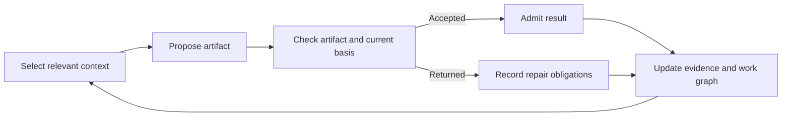

<p align="center"></p>

# Deep Create

**When an AI agent fails, what should survive?**

An agent produces a result. A verifier accepts it. But what happens when the verification itself is wrong?

A single false success can become the foundation for further work. A changed dependency can invalidate an earlier result. A failed branch can trigger unnecessary rework.

**DeepCreate explores a different architecture for autonomous AI: one where progress is represented through versioned state, explicit dependencies, and verifiable evidence — not just a growing conversation.**

The goal is to preserve what remains valid, identify what needs repair, and make the next attempt inherit evidence instead of repeating mistakes.

This repository makes the research available for inspection: an experimental Rust implementation, technical contracts, tests, and independent audits, including documented failures.
Created and directed by **[Ignat · @ignatXfire](https://x.com/ignatXfire)**. [Apache-2.0](LICENSE) · [Current status](RESEARCH_STATUS.md) · [Documentation](docs/README.md)

<!-- BEGIN_DEEP_CREATE_TRAILER -->

https://github.com/user-attachments/assets/c044996b-6c2c-4a58-af5b-00909287a29c

<!-- END_DEEP_CREATE_TRAILER -->

**[Open or download the trailer — 1:00](assets/deep-create-overview.mp4)** · **[Listen to the audio podcast — 39:30](assets/deep-create-podcast.m4a)** · **[Explore NotebookLM](https://notebook.google.com/notebook/61cb67ba-7c25-4228-8285-b90d303f5cff)**

<!-- ORIGINAL_X_POST_URL: after the owner supplies the actual launch-announcement URL, replace this comment with a standalone "Read my original announcement on X" link here. This is the original project announcement, not the later podcast post. Do not publish a placeholder URL. -->
<!-- PODCAST_X_POST_URL: after the owner supplies the separate podcast-video post URL, add it under "Watch, listen, and explore" with a "Watch my podcast on X" link. Do not reuse the announcement URL for the podcast or replace the bundled M4A. -->

The trailer illustrates the research; it is not a recording of a finished application. The companion notebook is an AI reading aid, not independent verification.

## Start with the evidence

- [Selective-repair transition test](crates/dc-domain/tests/cases/owner_return.rs): inspect how returned work and a proven-independent branch are treated differently. This is a synthetic component test, not a measured end-to-end speedup.
- [Independent audit — finding N03](independent-review-20261001/02_FINDINGS.md): a historical counterexample in which machine verification accepted the wrong work unit without criterion evidence. It is failure evidence, not a claim that the defect is fixed.

> [!WARNING]
> **The first-party implementation code was generated entirely by AI under Ignat's direction. Do not trust it without independent review.** Code, tests, reports, and AI explanations can be wrong. Before execution or reuse, inspect the actual paths and criteria, reproduce checks in isolation, and review security-sensitive behavior. Passing tests do not prove correctness or safety. This is an unfinished research prototype.

## The problem: activity can outlive useful progress

AI work can look busy while losing progress:

- A worker repeats a mistake lost during context compression.
- A result outlives the specification it depended on.
- One failed branch causes unrelated work to restart.
- A "passed" status lacks evidence for the requested artifact.

Deep Create studies how explicit work records and feedback can prevent that waste. More agents or iterations alone do not establish improvement.

## A concrete example: repair one branch, not everything

Result A is returned for repair; Result B is claimed to be independent. A's consumer must wait. B's consumer may continue only after its unaffectedness is checked against the new conditions.

The design retains both records, creates a specific repair obligation, and revisits the affected work.

Inspect the [owner-return transition test](crates/dc-domain/tests/cases/owner_return.rs). It exercises a synthetic component transition, **not** a durable desktop workflow. Avoiding unnecessary rework is the potential benefit; this test does not measure savings or establish that they exceed coordination costs.

## How the loop works

1. **Select context:** relevant sources, dependency versions, and unresolved feedback.
2. **Propose an artifact:** a candidate tied to a work unit and its basis, not automatically accepted state.
3. **Check the actual result:** compare it with the criteria and current basis; retain missing evidence and uncertainty.
4. **Accept or return:** preserve evidence, admit the result or create repair obligations, then rebuild the next context.



This is the intended mechanism; live verification, durable acceptance, and recovery have documented defects. It changes recorded work and context, not model weights. No end-to-end speedup, token saving, or superiority is established; improvement and convergence are not guaranteed.

## What you can inspect today

| Question | Start here | Evidence boundary |
|---|---|---|
| Can one returned result block its consumer without stopping a proven-independent consumer? | [Owner-return transition test](crates/dc-domain/tests/cases/owner_return.rs) | Synthetic component transition, not a durable end-to-end run |
| Can context based on changed dependencies be rejected? | [Context validation and tests](crates/dc-domain/src/context.rs) | Local validation, not proof that live retrieval always selects the right context |
| How should an unknown external outcome affect a retry? | [Continuation tests](crates/dc-domain/tests/cases/continuation.rs) and [recovery tests](crates/dc-watchdog/tests/recovery_evidence.rs) | Inspectable cases, not certification of the real external-effect boundary |
| What happens when the verifier itself is wrong? | [Independent findings, including N03](independent-review-20261001/02_FINDINGS.md) | Historical failure evidence, not a claim that the defect is fixed |

The immediate value for researchers is a corpus connecting intended contracts, implementation, tests, and counterexamples. Engineers can use it to investigate specific failure boundaries; researchers can reproduce or challenge component claims and design experiments. It is not a ready-to-deploy agent platform.

Read [why the cycle could help](publication/CYCLIC_WORK.md), the [claim-to-evidence map](publication/EVIDENCE_MAP.md), or the [evaluation protocol](publication/EVALUATION_PROTOCOL.md) before drawing performance conclusions. You do not need to read the entire repository to begin evaluating the idea.

## Repository map

| Area | Contents |
|---|---|
| `docs/technical` | Technical constitution, state and recovery, context, execution, authority, resource management, and verification scenarios |
| `docs/implementation` | Implementation notes, protocol codec, lifecycle, build instructions, and historical verification reports |
| `crates` | Nine Rust packages: domain, protocol, store, windows, watchdog, desktop, broker, worker, and core |
| `ui` | Experimental React and TypeScript interface |
| `tools` | Verification utilities and historical development helpers |
| `independent-review-20261001` | Independent audit, reproducing probes, and the source snapshot examined by that audit |
| `independent-review-20260929` | Earlier independent review for comparison |
| `ai_code_factory_700k_2026-10-02` | Separate development-organization research material, not evidence of capabilities implemented inside Deep Create |

Root-level evidence and status reports preserve the history of the project, including conflicting claims. Their dates and verification scope matter. [RESEARCH_STATUS.md](RESEARCH_STATUS.md) explains how to interpret them.

Fresh packaging checks and their actual exit codes are recorded in [publication validation](publication/VALIDATION.md). The [owner release checklist](publication/PUBLISHING.md) covers licensing, fresh Git history, and later demonstration media.

## Reading path

1. Start with the [documentation map](docs/README.md).
2. Read the technical constitution and the contracts relevant to your area.
3. Compare the implementation with the [October 1 independent review](INDEPENDENT_REVIEW_2026-10-01.md).
4. Inspect the [audit evidence and probes](independent-review-20261001/README.md).
5. Use the [research overview](publication/OVERVIEW.md) for a connected explanation of the design, code, and open questions.

## Exploring the code

Windows is the primary native target. Rust implements domain rules and native components, SQLite supports local state, Tauri provides the desktop shell, and TypeScript/React provides the interface. Dependency requirements are recorded in the manifests and lockfiles.

```powershell
node tools/check-architecture.mjs
cargo test --locked -p dc-domain -p dc-protocol -p dc-store
```

The historical architecture checker currently reports dependency-contract drift. A failed check is retained as evidence; this publication does not claim a fully passing build.

For the UI, use versions compatible with `package.json`. The source snapshot specifies Node `>=22.12.0 <23` and `pnpm@12.3.4`.

```powershell
pnpm install --frozen-lockfile
pnpm run check
pnpm run desktop:dev
```

Native Windows builds also need the pinned Rust toolchain, MSVC Build Tools, Windows SDK, and WebView2. Some historical helpers assumed a private local toolchain. Read [BUILD_PUBLIC.md](BUILD_PUBLIC.md) before running them. These instructions are not a claim that a fresh full build passed during publication preparation.

## Watch, listen, and explore

The [research trailer — 1:00](assets/deep-create-overview.mp4) opens with a historical wrong-unit verification finding, then illustrates result bindings, reviewed selective repair and evidence carried into the next attempt. It includes real component-source excerpts. This is an architectural explanation, not application-execution footage or a claim that the historical defect is fixed. The downloadable H.264/AAC MP4 is approximately 4.7 MB.

The [English audio podcast — 39:30](assets/deep-create-podcast.m4a), **Replacing AI Chat with Database Architecture**, is an AI-generated discussion of Deep Create's design. The original M4A is included without re-encoding. Open or download it to listen. Claims about readiness or performance should be checked against the repository's code and evidence, not accepted on the basis of the discussion.

The [companion NotebookLM notebook](https://notebook.google.com/notebook/61cb67ba-7c25-4228-8285-b90d303f5cff) offers another way to explore the project and related comparisons. Its source set is maintained separately from this repository. Generated explanations are reading aids, not independent verification; check their citations against the original files. Access depends on the notebook's sharing settings and may require a Google account.

Both media files are bundled in this repository; their links do not require a separate video or podcast hosting account.

Music in the short video: **Sascha Ende, ende.app — Happy Beats / Business Moves, Vol.12**, [CC BY 4.0](https://creativecommons.org/licenses/by/4.0/); excerpted with gain and fades. [Media credits and licensing boundaries](assets/MEDIA_CREDITS.md).

## Research directions

Open areas include durable command/result commits, verification against real artifacts and criteria, consistent UI/core identifiers, dependencies after failed work, revocation and protective reconciliation, worker isolation, and atomic resource accounting.

I'm sharing this work for research and independent continuation, and I don't plan to be its ongoing application developer. I don't promise active maintenance, issue/PR responses, completion dates, production security, or fully autonomous self-development. You can continue the project in a maintained fork under its license terms. See [CONTRIBUTING.md](CONTRIBUTING.md), [SECURITY.md](SECURITY.md), [authorship](AUTHORS.md), [citation metadata](CITATION.cff), and [third-party scope](THIRD_PARTY_NOTICES.md).

If you'd like to support me, [you can make a donation here](SUPPORT.md). I'd really appreciate it.

## Contact

Email: [ignatxfire@gmail.com](mailto:ignatxfire@gmail.com).
