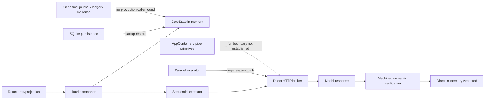

# Architecture, readiness and work order

## Current connection of mechanisms

This is a map of the found caller paths, not a complete diagram of all future components. The main architectural risk is that a module with the desired name exists, but the current route does not use it or bypasses its contract.

## What is really ready at the basic level

There are meaningful domain types and transitions, codec/replay, SQLite CAS, new hash-backed storage primitives, real Job/DPAPI API, native command handlers, model HTTP adapter, tracing/health and a significant number of artificial checks. Several previous panic and incompatibilities have been fixed. This is real progress.

In development: a real durable command boundary, scheduler admission in both executors, meaningful verification of artifacts and criteria, provenance evidence connections, process authority/containment, a full-fledged unknown/budget protocol, contextual projection and several long-term related works. Some mechanisms are partially implemented, some exist primarily as types/bookkeeping.

Deep Create’s full own cycle of self-development has not been proven: goal → own planner/context → allowed worker/model → isolated patch → real tests → independent review → authoritative integration → next dependent task. An external Hermes/Codex organization, even one successfully working with its sources, is not automatic proof of this own cycle.

## Percent

There is no measured full percentage: there is no independently verified denominator of all requirements 07/13–26 and evidence for each. The number of files, commits, tests or pages does not replace it.

**My preliminary engineering estimate of the full promised product is about 25–40%, confidence is low.** This is a subjective range, not a proportion of closed contractual requirements. Foundation: the foundation and some integrations have grown noticeably, but P1s remain in launch attempts, durable acceptance, verification correctness, dependencies, unknown and OS authority. The transition from the previous 20–35 to this range cannot be interpreted as a measured increase of 5 percentage points.

Having these blockers is more important than percentage when deciding on a valuable account. The complete chain of security clearance has not yet been proven. The anti-detect and proxy do not correct process access to cookies/files, request repetition, or false acceptance of the result. First, fake provider and artificial data; then a separate VM/profile and a limited test account after checking the boundaries.

## How to fix without losing the idea

1. **Acceptance:** wrong unit/scope/attempt/snapshot → refusal; no evidence/method → ​​Indeterminate. The verification of each criterion must have qualification and artifact provenance. Disable direct Accepted from desktop.
2. **Single writer:** command validation → transaction state+event+reservation/outcome+verification → commit receipt. API queue/admitted/committed are distinguishable. Create a schema gate and evidence blob/link separation.
3. **Exact vertical chain:** fix projection/start parser; This IPC conveys the purpose and criteria; artificial worker receives ContextProjection; the result is saved and checked; restart restores correct operation. This is a test of the carrier chain, not a reduction of the entire system to a simple chat.
4. **Scheduler:** unit is allowed after the currently accepted dependencies, fences and budget; unknown/refusal/cancel parent blocks dependent units. Connect parallel executor only after these invariants.
5. **OS/effects:** real peer/token authentication and AppContainer creation, guard !Send/!Sync, actual CPU limits, prohibition of blind retry after possible sending; shutdown drain/fence/persist barrier.
6. **Long jobs and context:** multiple jobs, shared objects, revision-linked inputs, branch provenance; compression is a projection of the saved history. Test compound cases of goal/context/rights/generation change.
7. **Self-development:** your own actuator must leave patch/evidence/review/integration provenance. Independent reviewer is not the author; the new version is not accepted by the model's own text.
8. **Operation:** fresh binary hash, clean VM, migrations and rollback, installation/removal, checked soak, storage faults and recovery after power failure separately from process kill.

Reasonable parallelism: UI DTO slice, storage commit slice, OS boundary slice and oracle tests - in different designated candidates. Common identity/authority/receipt types are negotiated by a single owner. Integration and acceptance are consistent; Do not overwrite the saved changes of others.

## Deadlines

A real calendar forecast based on these data is impossible: there is no stable measured speed of independently accepted integrated requirements. The recent session confirms high activity, but also repeated repairs, linker blockers and re-evaluation of old evidence. Generating thousands of rows is not throughput acceptance.

My planning opinion: the first sustainable artificial end-to-end scenario requires more than weeks, the full declared autonomous product requires months. This is not a promise of a date or a calculation based on the current number of agents. A reliable forecast will appear after two week-long cycles with the registry of accepted obligations, reopening rate, integration delay and the critical path. Do not use the desired date “today” as evidence of technical feasibility.
